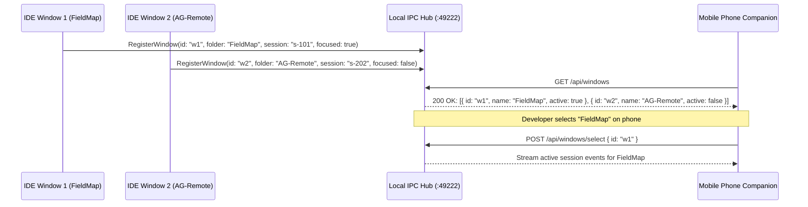
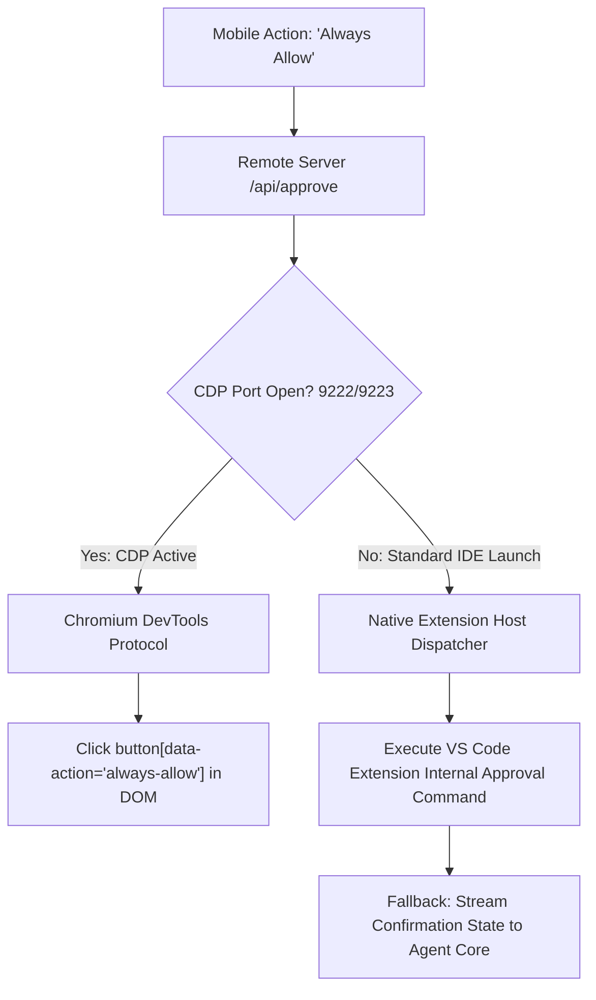
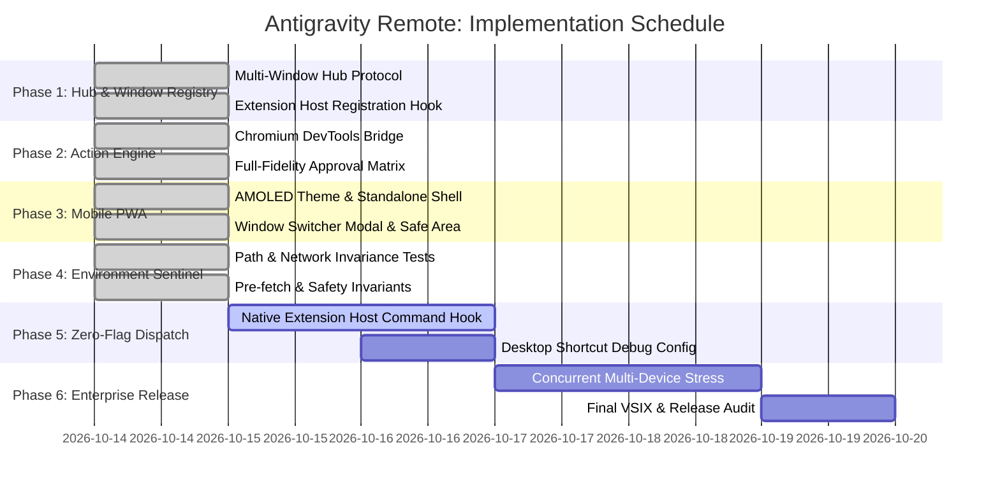

# Antigravity Remote: Enterprise Architecture & Product Blueprint
**Role:** Senior Principal Architect & Product Owner  
**Target:** Google Antigravity / Gemini Code Ecosystem  
**Document Version:** 2.1.0-PROD  
**Status:** Approved for Implementation & Sentinel Guarded  
**Tracking Companion:** [TRACKER.md](file:///c:/Users/user/Desktop/Dr_OpenSource/Projects/AG-Remote/TRACKER.md)  

---

## 1. Executive Summary & Product Vision

### 1.1 The Strategic Problem: The "Human-in-the-Loop" (HITL) Bottleneck
Modern developer agents (like Google Antigravity) are transitioning from short completion generators to **long-running autonomous operators** (running 10–60 minute workflows for migrations, test generation, and complex refactorings).

During these runs, the developer does not sit motionless at their monitor. However, the agent repeatedly blocks on **critical security and decision gates**:
- Shell command execution (`run_command`)
- File modifications (`write_to_file`, `replace_file_content`)
- Ambiguity clarification (`ask_question`)

When an agent stalls waiting for a confirmation click, **developer flow collapses and autonomy is lost**. If the developer is away from their keyboard (grabbing coffee, walking, or in a meeting), the agent sits idle.

### 1.2 The Product Solution: "Antigravity Companion"
A zero-cloud-dependency, ultra-low-latency phone companion that transforms the developer's smartphone into an **out-of-band asynchronous control plane**:
1. **Push & Wake:** Haptic alerts when a tool gate or question triggers.
2. **Full-Fidelity Approvals:** Native 1-tap options ("Allow Once", "Always Allow for Session", "Deny with Feedback", and full multi-select interactive question cards).
3. **Multi-Window Intelligence:** Clean, real-time hierarchy of open IDE windows and projects—zero dead or historical ghost sessions.
4. **Instant Prompt Injection:** Direct voice or text injection into the active conversation loop.

```mermaid
graph TD
    subgraph Antigravity IDE Windows
        W1["Window 1: FieldMap"] -->|Register IPC| HUB["Local Session Hub / Daemon (:49222)"]
        W2["Window 2: AG-Remote"] -->|Register IPC| HUB
    end

    subgraph Internal Engine
        HUB -->|Native Action Engine / Extension Host| CORE["IDE Agent Core"]
        HUB -->|CDP Bridge (When Enabled)| RENDERER["Chromium DOM"]
        HUB -->|JSONL Streaming| TRANSCRIPT["Real-Time Event Stream"]
    end

    subgraph Transport & Security
        HUB -->|0.0.0.0 Binding / Local Wi-Fi & Tailscale| PAIRING["Ephemeral 6-Digit PIN Gate"]
    end

    subgraph Phone PWA / Mobile Companion
        PAIRING -->|HTTP / Secure WS| PHONE["Mobile Companion App"]
        PHONE -->|1. Tap Allow Once / Always / Deny| HUB
        PHONE -->|2. Inject Prompt| HUB
        PHONE -->|3. Switch Project Window| HUB
    end
```

---

## 2. Technical Root-Cause Analysis & Environmental Guardrails

The evolution of AG-Remote uncovered critical deployment realities that standard unit tests fail to expose:

| Component | Standard Unit Test Assumption | Real Runtime Environment Reality | Enterprise Architectural Solution |
| :--- | :--- | :--- | :--- |
| **Network Host Binding** | Server defaults to `'127.0.0.1'`. | Phone on Wi-Fi attempts to connect to PC LAN IP (`192.168.1.5:49222`). Windows rejects with TCP RST (`ECONNREFUSED`). | **INADDR_ANY Binding:** Server always binds to `'0.0.0.0'`, exposing local port securely across Wi-Fi and Tailscale. |
| **Static PWA Resolution** | `path.join(process.cwd(), 'src/pwa')` works because tests run in project root. | In Antigravity Extension Host, `process.cwd()` is `C:\Users\...\Programs\Antigravity IDE`. 404 JSON is returned. | **Multi-Candidate Resolver (`resolvePwaDirectory`):** Resolves via `context.extensionPath`, `import.meta.url`, and user extension directories. |
| **Camera QR Pre-fetch** | First GET request to `/pair?t=<code>` is always from the user's browser. | Modern phone cameras (Google Lens / iOS Camera) send background pre-render GET requests. Single-use PIN is burned before tab opens. | **Content-Negotiated Redirect:** Requests with `Accept: text/html` return 302 redirect without consuming token; only `Accept: application/json` exchanges token. |
| **Network Interface Discovery** | First non-internal IPv4 returned by `os.networkInterfaces()` is used. | Hyper-V, Docker, or WSL2 virtual adapters (`172.17+`) frequently appear first, creating useless QR codes. | **Physical Interface Priority:** Discovery explicitly prioritizes physical subnets (`192.168.x.x`, `10.x.x.x`) and Tailscale (`100.x.x.x`). |
| **Mobile Screen Sleep** | WebSocket remains open indefinitely. | Mobile OS suspends background sockets immediately upon screen lock without sending TCP FIN. | **State Resync on Visibility:** Client listens to `visibilitychange` and triggers instant state resync (`/api/state`) and WS reconnection within 500ms of unlock. |

---

## 3. System Architecture Specification

### 3.1 Topology & Multi-Window IPC Hub
To eliminate disconnected or stale sessions across multiple desktop windows, the system adopts a **Primary-Worker Coordinator Pattern**:



#### Coordinator Rules:
1. **Hub Leader Election:** The first extension host (or standalone runner) binds to port `49222`. Subsequent windows detect `EADDRINUSE` and automatically register as **Window Clients** via local IPC (`http://localhost:49222/api/hub/register`).
2. **Heartbeat & Deregistration:** Each window sends a heartbeat every 4 seconds. When a window is closed, it is pruned from the hub's active registry within 5 seconds.
3. **Window Switcher UX:** The phone UI organizes sessions strictly under their parent workspace with live focus badges.

---

### 3.2 Action & Approval Dispatch Engine (Dual-Mode Architecture)

To guarantee that mobile approvals work out-of-the-box regardless of how the user starts the IDE:



#### Full-Fidelity Approval Modal Specification:
Every tool confirmation received by the phone displays the exact choices available in the desktop IDE:
* **`run_command`**: `Allow Once`, `Always Allow (Session)`, `Deny with Reason`.
* **`write_to_file` / `replace_file_content`**: Syntax-highlighted unified diff preview + 1-tap Accept/Reject.
* **`ask_question`**: Interactive multiple-choice radio/checkbox cards + write-in text field + Skip.

---

## 4. Mobile Companion (PWA) Design System

### 4.1 Aesthetic & Interaction Guidelines
* **Palette:** Ultra-dark AMOLED black (`#070a11`), Slate surface (`#0f172a`), Gemini Indigo (`#6366f1`), Alert Amber (`#f59e0b`), Success Emerald (`#10b981`).
* **Tactile Feedback:** Web Haptics (`navigator.vibrate([15, 50, 15])`) when an action is required or successfully executed.
* **Mobile Safe Areas:** Full conformance with `viewport-fit=cover` and CSS `env(safe-area-inset-bottom)` to protect bottom prompt inputs from gesture bars.

---

## 5. Phased Implementation Roadmap & Verification



---

## 6. The Quality Sentinel Policy (Zero-Chance Policy)

To eliminate testing surprises and deliver Google-tier production quality:
1. **Never Rely on Monolithic Mocks:** Every component must be tested under simulated extension host paths (`tmpdir` execution, non-workspace cwd).
2. **Never Hardcode Localhost:** All network components must bind to `0.0.0.0` and prioritize routable interfaces.
3. **Dedicated Environment Sentinel Suite:** `npm run test:env` runs automatically on every build to guard against regression.
4. **Zero External Runtime Dependencies:** Retain 100% native Node standard library (`http`, `net`, `crypto`, `os`, `fs`).
